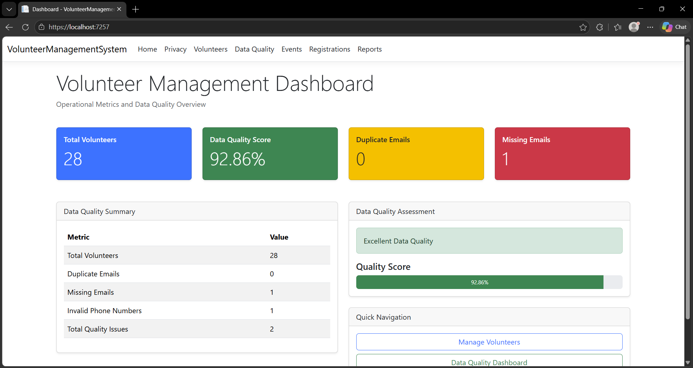
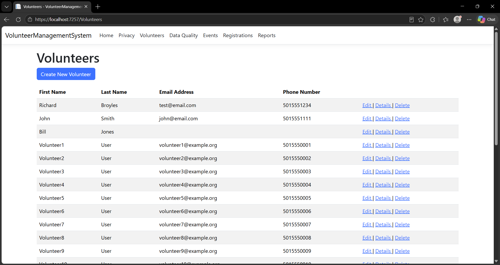

# Volunteer Management System

ASP.NET Core MVC | Entity Framework Core | SQL Server

A portfolio project demonstrating volunteer management, attendance tracking, data quality monitoring, operational reporting, and business rule enforcement.

---

## Overview

The Volunteer Management System (VMS) is a web-based application designed to manage:

- Volunteers
- Events
- Registrations
- Attendance
- Data Quality Metrics
- Operational Reporting

The project was built to demonstrate application development, systems analysis, information quality management, and application support skills.

---

## Features

### Volunteer Management

- Create Volunteers
- Edit Volunteers
- Delete Volunteers
- Volunteer Search

### Event Management

- Create Events
- Event Capacity Tracking
- Event Status Management

### Registration Management

- Register Volunteers for Events
- Prevent Duplicate Registrations
- Registration Status Tracking

### Attendance Tracking

- Record Attendance
- Track Volunteer Hours
- Attendance Status Tracking

### Data Quality Dashboard

- Duplicate Registration Detection
- Missing Contact Information
- Attendance Exceptions
- Capacity Alerts

### Reporting

- Volunteer Hours Leaderboard
- Registration Metrics
- Attendance Metrics

---

## Screenshots

### Executive Dashboard



### Volunteer Management



### Registration Dashboard


### Attendance Management


### Volunteer Hours Report


---

## System Architecture

```text
Volunteer
    │
    ▼
Registration
    ▲
    │
Event
    │
    ▼
Attendance
```

---

## Entity Relationship Diagram

```text
Volunteers
----------
VolunteerId (PK)

Events
------
EventId (PK)

Registrations
-------------
RegistrationId (PK)
VolunteerId (FK)
EventId (FK)

Attendance
----------
AttendanceId (PK)
VolunteerId (FK)
EventId (FK)
```

Add ERD image here:


---

## Business Rules

### Registration Rules

- Volunteer must exist
- Event must exist
- Volunteer may not register twice for the same event
- Event capacity may not be exceeded

### Attendance Rules

- Volunteer must exist
- Event must exist
- One attendance record per volunteer/event
- Hours served must be between 0 and 24

### Data Quality Rules

- Volunteer email addresses must be unique
- Duplicate registrations are prohibited
- Invalid attendance entries are identified
- Capacity exceptions are monitored

---

## Data Quality Controls

| Control | Type |
|----------|----------|
| Unique Volunteer Email | Unique Index |
| Volunteer Registration Uniqueness | Composite Unique Index |
| Attendance Uniqueness | Composite Unique Index |
| Volunteer Foreign Key | Referential Integrity |
| Event Foreign Key | Referential Integrity |
| Attendance Status Validation | Check Constraint |
| Hours Validation | Check Constraint |

---

## Operational Dashboards

### Registration Dashboard

Metrics:

- Total Registrations
- Registered
- Waitlisted
- Cancelled

### Capacity Monitoring

Identifies:

- Events above 80% capacity
- Potential overbooking risk

### Attendance Exceptions

Identifies:

- Present with Zero Hours
- Attendance Without Registration
- Excessive Hours
- Missing Status

---

## Reports

### Volunteer Hours Leaderboard

Displays:

- Volunteer Rank
- Total Hours Served
- Events Attended

### Attendance Analytics

Displays:

- Present Count
- Absent Count
- Excused Count
- Total Volunteer Hours

---

## Technology Stack

### Front-End

- Razor Views
- Bootstrap 5

### Back-End

- ASP.NET Core MVC
- C#

### Database

- SQL Server
- Entity Framework Core

### Development Tools

- Visual Studio
- SQL Server Management Studio
- Git
- GitHub

---

## Database Constraints

### Volunteers

```sql
UNIQUE (EmailAddress)
```

### Registrations

```sql
UNIQUE (VolunteerId, EventId)
```

### Attendance

```sql
UNIQUE (VolunteerId, EventId)
```

### Status Validation

```sql
CHECK AttendanceStatus
```

```sql
CHECK RegistrationStatus
```

---

## Reporting Examples

Example Volunteer Leaderboard:

```text
Rank  Volunteer            Hours

1     Richard Broyles      84.5

2     John Smith           67.0

3     Mary Jones           52.0
```

---

## Test Data

A synthetic data generator script is included.

Populates:

- Volunteers
- Events
- Registrations
- Attendance

Also generates sample data-quality exceptions for testing dashboards.

---

## Future Enhancements

- Authentication & Authorization
- Volunteer Certifications
- Event Waitlists
- Export to Excel
- Advanced Analytics Dashboard
- Volunteer Achievement Tracking

---

## Skills Demonstrated

### Software Development

- ASP.NET Core MVC
- C#
- Entity Framework Core
- SQL Server

### Systems Analysis

- Business Rule Definition
- Relational Database Design
- Process Modeling

### Data Quality

- Data Profiling
- Exception Reporting
- Constraint Enforcement
- Data Validation

### Application Support

- Operational Dashboards
- Monitoring Metrics
- Incident Analysis Concepts
- Data Quality Monitoring

---

## Author

Richard Broyles

BS Information Science
MS Information Quality

Focused on:

- Systems Analysis
- Application Support
- Data Quality Management
- Software Development
